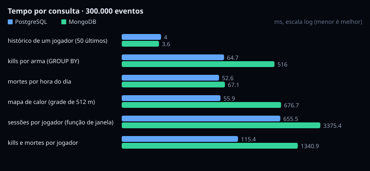

# PostgreSQL x MongoDB com os mesmos dados

Quis responder com número uma pergunta que aparece toda hora: pra guardar eventos de jogo
(kills, mortes, hits, entrada e saída de jogador), vale mais um banco relacional ou um banco de documentos?

O mesmo conjunto de 300 mil eventos vai para os dois bancos, cada um modelado do jeito que
faria sentido usar de verdade, e as mesmas seis perguntas são feitas aos dois. Antes de medir o tempo, o
programa confere se as duas respostas são **idênticas**. Se uma consulta devolver algo diferente, o
benchmark para. Sem essa conferência, dá pra "ganhar" de um banco só respondendo outra pergunta.



## Os dois modelos

| | PostgreSQL 18 | MongoDB 8.0 |
|---|---|---|
| Modelo | normalizado: `players` e `events`, com FK e CHECK | um documento por evento, com o nome do jogador copiado dentro |
| Carga | `COPY` | `insert_many` em lotes de 10 mil |
| Índices | `(type, ts)`, `(player_id, ts)`, `(killer_id, ts)` parcial | os mesmos três, sendo o de `killer.id` sparse |
| Agregação | SQL, `GROUP BY`, `LAG()` | aggregation pipeline, `$group`, `$setWindowFields`, `$unionWith` |

O documento no Mongo fica assim:

```json
{ "type": "kill", "ts": ISODate("2026-11-02T21:14:07.311Z"),
  "player": { "id": "p0412", "name": "Corvo" },
  "killer": { "id": "p0077", "name": "Lobo" },
  "pos": [7421.5, 10233.0], "weapon": "M4A1", "distance": 182.4 }
```

## Resultado (300.000 eventos, 2.000 jogadores, mediana de 5 rodadas)

| Consulta | PostgreSQL | MongoDB | |
|---|---:|---:|---|
| histórico de um jogador (50 últimos) | 4,0 ms | 3,6 ms | empate |
| kills por arma | 64,7 ms | 516,0 ms | pg 8x |
| mortes por hora do dia | 52,6 ms | 67,1 ms | pg 1,3x |
| mapa de calor (grade de 512 m) | 55,9 ms | 676,7 ms | pg 12x |
| sessões por jogador (janela) | 655,5 ms | 3.375,4 ms | pg 5x |
| kills e mortes por jogador | 115,4 ms | 1.340,9 ms | pg 11x |
| **carga dos 300 mil** | 18,9 s | 19,0 s | empate |
| **renomear um jogador** | 15,1 ms (1 linha) | 18,3 ms (228 documentos) | ver abaixo |
| **espaço em disco (dados + índices)** | 53,9 MB | 31,3 MB | mongo ocupa 42% menos |

Os números brutos estão em [`results/results.json`](results/results.json). Rodei no WSL (Ubuntu),
com os dois servidores na configuração padrão e o mesmo cliente Python 3.14.

## O que eu tirei disso

**Busca pontual é empate.** O histórico de um jogador usa índice nos dois bancos e devolve 50 linhas.
Nesse caso o custo de verdade é a ida e volta pela rede, não o banco.

**Nas agregações o Postgres ganhou de longe, e o motivo apareceu no `EXPLAIN`.** Os dois usam o índice
`(type, ts)` para achar os 60 mil kills. O Postgres faz um *bitmap scan*: junta os endereços, ordena
por página e lê 3.364 páginas em sequência, sem leituras repetidas. O Mongo faz `IXSCAN` seguido de
`FETCH`: busca documento por documento na ordem do índice (por data, não por posição no disco) e
ainda precisa abrir cada BSON pra pegar os campos. Com 60 mil documentos, essa diferença vira 8x.

**Desnormalizar tem custo e ele aparece na escrita.** No Postgres, trocar o nome de um jogador mexe em 1 linha.
No Mongo, o nome está copiado em todo evento em que ele aparece, como vítima ou como matador, e por
isso foram 228 documentos. O tempo ficou parecido porque os dois campos têm índice, mas o número cresce com
o histórico do jogador, e as duas `update_many` não são atômicas fora de uma transação. Se o
processo cair no meio, o jogador fica com um nome como vítima e outro como matador.

**O Mongo ocupa bem menos disco.** O WiredTiger comprime os dados (snappy) e usa compressão de prefixo
nos índices. O Postgres só comprime valores grandes (TOAST), então linhas pequenas como essas ficam
sem compressão. Pra quem guarda anos de log, isso pesa.

**Quando eu escolheria o Mongo pra isso:** quando o formato do evento muda bastante (cada tipo de evento com
campos diferentes, versões de mod adicionando coisa nova), quando a leitura principal é "me dá o
documento inteiro" e quando espaço em disco importa mais que relatório. Pros relatórios de
servidor que eu queria (ranking, K/D, mapa de calor, tempo jogado), o relacional respondeu melhor.

## Limites do teste

- Uma máquina só, sem réplica, sem sharding. É exatamente onde o Mongo não mostra a vantagem dele.
- Configuração padrão nos dois. Com `shared_buffers` e `work_mem` ajustados o Postgres melhora; com
  um índice que cubra a consulta (`type, weapon, distance`) o Mongo deixa de precisar do `FETCH`.
  Deixei padrão de propósito, pra comparar o que cada um entrega sem ajuste.
- Os dados são gerados (semente fixa, sempre os mesmos). A distribuição imita um servidor real, mas
  não é um log real.

## Rodando

Precisa de um PostgreSQL e um MongoDB acessíveis. Por padrão usa `127.0.0.1` nas portas de sempre.

```bash
python -m venv .venv
.venv/bin/pip install -e ".[dev]"

# usuário e banco no Postgres
sudo -u postgres psql -c "CREATE ROLE bench LOGIN PASSWORD 'bench_dev' CREATEDB"
sudo -u postgres psql -c "CREATE DATABASE bench OWNER bench"

.venv/bin/pytest -v                                  # paridade entre os dois bancos
.venv/bin/python -m bench.run --events 300000        # benchmark completo, grava results/
```

Variáveis: `BENCH_PG` (DSN do Postgres), `BENCH_MONGO` (URI do Mongo) e `BENCH_MONGO_DB`.

## Estrutura

```
bench/
  data.py      gerador de eventos determinístico
  pg.py        schema, carga via COPY e as consultas em SQL
  mongo.py     carga e as mesmas consultas em aggregation pipeline
  compare.py   normaliza os resultados (Decimal, datas, floats) pra comparar
  run.py       carrega, confere a paridade, mede e grava results/
  chart.py     gráfico SVG sem biblioteca
tests/
  test_parity.py   cada consulta tem que dar a mesma resposta nos dois bancos
```

O CI sobe Postgres 18 e Mongo 8.0 como serviços, roda os testes de paridade e um benchmark pequeno.

## Licença

MIT
